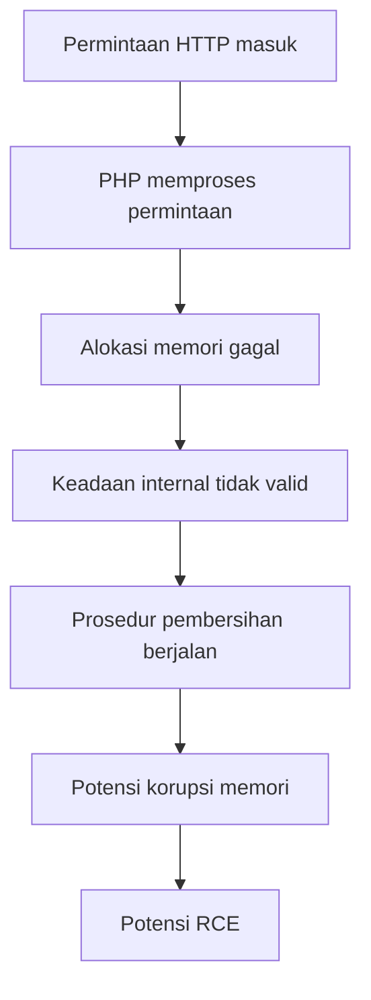
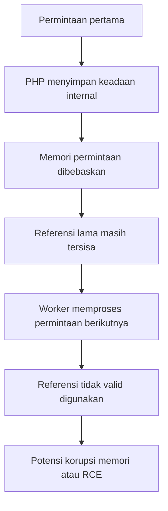
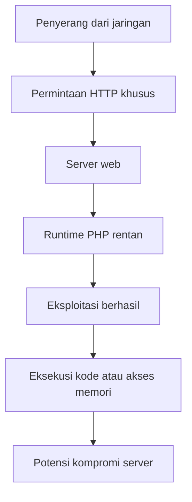
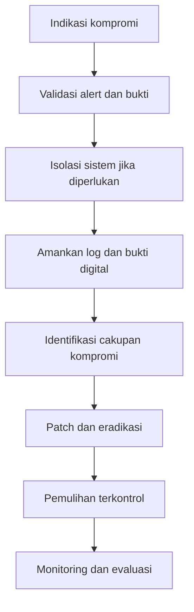

Pada Oktober 2026, dua kerentanan kritis pada PHP diumumkan dengan nama **PHP2Shell**, yaitu CVE-2026-109618 dan CVE-2026-109619. Kedua kerentanan tersebut berkaitan dengan pengelolaan memori dan penanganan permintaan pada runtime PHP. Eksploitasi yang berhasil dapat memungkinkan penyerang menjalankan kode dari jarak jauh atau mengakses informasi sensitif dari memori proses PHP.

Kedua kerentanan tersebut dilaporkan memiliki skor CVSS 4.0 sebesar 9,2 dari 10, sehingga memerlukan perhatian serius dari administrator server dan pengelola aplikasi web.

PHP2Shell bukan nama sebuah framework, library, atau plugin PHP. Istilah ini merujuk pada sepasang kerentanan yang memengaruhi runtime PHP dan dapat berdampak pada aplikasi yang berjalan di atasnya.

<!-- truncate -->

Sumber referensi:

- [PHP Security Advisories](https://www.php.net/archive/2026.php)
- [Ubuntu: PHP2Shell vulnerability fixes available](https://ubuntu.com/blog/php2shell-vulnerability-fixes-available)
- [NHS England Digital: Critical Vulnerabilities in PHP](https://digital.nhs.uk/cyber-alerts/2026/cc-4875)

## Apa Itu PHP2Shell?

PHP2Shell adalah sebutan untuk dua kerentanan keamanan pada runtime PHP yang berpotensi memungkinkan *remote code execution* (RCE).

RCE merupakan kondisi ketika penyerang dapat menjalankan kode pada sistem target dari jarak jauh. Dalam konteks server web, kemampuan ini dapat memberikan akses terhadap sumber daya yang dapat dijangkau oleh proses PHP.

Hal yang membuat PHP2Shell berbahaya adalah potensi eksploitasi tanpa autentikasi pada jalur pemrosesan permintaan tertentu. Artinya, penyerang tidak selalu perlu memiliki akun pengguna atau akses ke dashboard aplikasi untuk mencoba mengeksploitasi server yang rentan.

Kerentanan ini dapat memengaruhi berbagai arsitektur deployment PHP, termasuk Apache dengan `mod_php`, PHP-FPM, dan konfigurasi server lain yang menggunakan runtime terdampak.

Namun, keberhasilan eksploitasi tidak selalu sama pada setiap lingkungan. Versi PHP, konfigurasi, ekstensi, dan cara server memproses permintaan dapat memengaruhi jalur serta keandalan eksploitasi.

## Identifikasi Kerentanan PHP2Shell

PHP2Shell terdiri dari dua kerentanan dengan mekanisme yang berbeda.

| Identitas | Mekanisme | Potensi dampak |
|---|---|---|
| CVE-2026-109618 | Korupsi memori ketika terjadi *out-of-memory* (OOM) | Remote code execution |
| CVE-2026-109619 | Penggunaan kembali referensi memori yang sudah tidak valid (*stale global state*) | Remote code execution atau akses terhadap data sensitif |

Keduanya berkaitan dengan pengelolaan keadaan internal PHP ketika pemrosesan permintaan berakhir secara tidak normal.

## CVE-2026-109618: Out-of-Memory Corruption

### Mekanisme kerentanan

PHP mengalokasikan memori untuk menyimpan data permintaan, variabel, dan struktur internal selama pemrosesan aplikasi.

Ketika alokasi memori gagal, PHP harus menghentikan operasi yang sedang berjalan dan membersihkan sumber daya yang telah digunakan.

Masalah terjadi ketika proses penanganan kesalahan meninggalkan struktur internal dalam keadaan belum sepenuhnya terinisialisasi. Prosedur pembersihan berikutnya kemudian dapat membaca atau menggunakan struktur yang tidak valid.

Kondisi tersebut berpotensi menimbulkan korupsi memori dan, dalam keadaan tertentu, memungkinkan eksekusi kode.

### Alur sederhana



Diagram tersebut menggambarkan konsep kerentanannya, bukan urutan eksploitasi yang pasti terjadi pada setiap server.

### Mengapa kondisi OOM berbahaya?

Kesalahan OOM biasanya dipandang sebagai masalah ketersediaan layanan. Akan tetapi, dalam kerentanan ini, masalahnya bukan hanya proses kehabisan memori.

Yang menjadi persoalan adalah bagaimana runtime menangani kondisi kegagalan tersebut. Jika penanganan kesalahan tidak menjaga konsistensi struktur internal, kesalahan yang awalnya hanya menyebabkan kegagalan alokasi dapat berkembang menjadi masalah keamanan memori.

## CVE-2026-109619: Stale Global State

### Mekanisme kerentanan

PHP menggunakan berbagai variabel dan struktur internal untuk menyimpan keadaan selama pemrosesan permintaan.

Sebagian referensi internal dapat menunjuk ke memori yang masa pakainya hanya berlaku selama satu permintaan. Setelah permintaan selesai, memori tersebut seharusnya dibebaskan dan referensinya tidak boleh digunakan kembali.

Kerentanan muncul ketika keadaan internal tertentu masih menyimpan referensi ke memori yang sudah dibebaskan atau ketika keadaan tersebut kembali diisi dengan referensi yang tidak valid.

Jika worker PHP memproses permintaan berikutnya dengan keadaan yang belum sepenuhnya dibersihkan, referensi tersebut berpotensi digunakan kembali. Dalam kondisi tertentu, hal ini dapat menyebabkan akses memori yang tidak valid dan eksekusi kode.

### Alur sederhana



### Hubungannya dengan request cleanup

Dalam server yang menggunakan worker persisten, proses PHP dapat menangani lebih dari satu permintaan selama masa hidupnya.

Karena itu, pembersihan keadaan internal setelah setiap permintaan menjadi sangat penting. Referensi yang seharusnya sudah tidak berlaku tidak boleh memengaruhi pemrosesan permintaan selanjutnya.

Kerentanan ini menunjukkan bahwa kesalahan pengelolaan memori pada satu tahap pemrosesan dapat menimbulkan risiko pada tahap berikutnya.

## Bagaimana PHP2Shell Dapat Berdampak pada Aplikasi Web?

Aplikasi seperti WordPress, Drupal, dan Joomla menggunakan PHP untuk memproses permintaan, menjalankan logika aplikasi, dan mengakses data.

Jika runtime PHP yang mendasarinya rentan, keamanan aplikasi tidak hanya bergantung pada kualitas kode aplikasi tersebut. Kerentanan pada runtime dapat membuka jalur serangan yang berada di bawah lapisan aplikasi.

Gambaran umumnya adalah sebagai berikut:



Dampak akhirnya bergantung pada hak akses proses PHP, izin file, segmentasi jaringan, dan kontrol keamanan yang diterapkan.

Sebagai contoh, jika proses PHP hanya memiliki akses tulis ke direktori unggahan, dampak awalnya dapat berbeda dibandingkan server yang menjalankan proses PHP dengan hak akses terlalu luas.

## Dampak Keamanan PHP2Shell

### 1. Remote Code Execution

Penyerang yang berhasil mengeksploitasi kerentanan dapat memperoleh kemampuan menjalankan kode pada sistem target. Ini merupakan dampak yang paling serius karena dapat menjadi titik awal kompromi lebih lanjut.

### 2. Akses terhadap informasi sensitif

Data yang dapat dijangkau proses PHP berpotensi mencakup konfigurasi aplikasi, informasi sesi, kredensial yang tersimpan secara tidak aman, atau data pengguna.

Akses tersebut tidak berarti semua data server otomatis dapat dicuri. Hasilnya bergantung pada kondisi eksploitasi dan batas akses proses.

### 3. Pemasangan web shell

Jika penyerang memperoleh kemampuan eksekusi kode sekaligus izin menulis yang memadai, penyerang mungkin dapat menanam web shell atau mekanisme akses persisten lainnya.

Web shell dapat memungkinkan interaksi lanjutan dengan server melalui permintaan web.

### 4. Gangguan ketersediaan layanan

Permintaan yang memicu kesalahan memori dapat menyebabkan worker atau proses PHP gagal. Jika kondisi tersebut terjadi berulang kali, layanan web dapat mengalami penurunan kinerja atau gangguan.

### 5. Kompromi sistem lain

Jika server memiliki akses ke database, penyimpanan bersama, layanan internal, atau kredensial untuk sistem lain, penyerang mungkin mencoba memperluas aksesnya.

Risiko ini semakin besar ketika segmentasi jaringan dan pembatasan hak akses tidak diterapkan dengan baik.

## Versi PHP yang Perlu Diperiksa

Rilis keamanan PHP pada 21 Oktober 2026 menyediakan perbaikan untuk cabang berikut.

| Cabang PHP | Versi perbaikan |
|---|---|
| PHP 8.5 | 8.5.12 |
| PHP 8.4 | 8.4.27 |
| PHP 8.3 | 8.3.36 |
| PHP 8.2 | 8.2.35 |

Versi sebelum rilis perbaikan pada setiap cabang perlu diperiksa. PHP 8.1 dan versi yang lebih lama juga perlu mendapat perhatian karena telah mencapai akhir masa dukungan atau tidak lagi memperoleh pembaruan resmi reguler.

Untuk instalasi yang dikelola distribusi Linux atau vendor hosting, periksa advisory vendor. Perbaikan dapat diberikan melalui *backport*, sehingga nomor versi paket tidak selalu sama dengan nomor rilis PHP upstream.

Referensi:

- [PHP Security Advisories](https://www.php.net/archive/2026.php)
- [PHP Release Archive](https://www.php.net/releases/)
- [Ubuntu Security](https://ubuntu.com/security)

## Cara Memeriksa Versi PHP

Administrator perlu memeriksa seluruh instalasi PHP yang digunakan oleh server, bukan hanya PHP CLI.

### Memeriksa PHP CLI

Jalankan perintah berikut:

```bash
php -v
```

Perintah tersebut menampilkan versi PHP CLI yang dipanggil melalui `PATH`.

### Memeriksa paket PHP pada Ubuntu atau Debian

```bash
dpkg -l | grep -E 'php[0-9.]'
```

Perintah ini membantu mengidentifikasi paket PHP yang terpasang pada sistem berbasis Debian.

### Memeriksa PHP-FPM

Pada sistem yang menggunakan PHP-FPM, periksa layanan yang tersedia:

```bash
systemctl list-units --type=service --all | grep -i php
```

Nama layanan dapat berbeda berdasarkan versi dan konfigurasi sistem.

Jika aplikasi berjalan di Docker, periksa versi PHP dari container yang menjalankan aplikasi. Versi PHP pada host tidak selalu sama dengan versi yang berada di dalam container.

## Langkah Mitigasi dan Perbaikan

### 1. Perbarui PHP ke versi yang telah diperbaiki

Pembaruan runtime merupakan langkah utama untuk mengatasi akar kerentanan.

Pada Ubuntu atau Debian, mulai dengan:

```bash
sudo apt update
sudo apt upgrade
```

Perintah tersebut hanya memperbarui paket sesuai konfigurasi repositori. Administrator harus memastikan repositori yang digunakan telah menyediakan paket PHP yang memuat perbaikan PHP2Shell.

Untuk sistem produksi, lakukan pencadangan, uji kompatibilitas aplikasi, dan siapkan prosedur pemulihan sebelum perubahan yang berisiko.

### 2. Restart layanan yang menggunakan PHP

Setelah pembaruan, pastikan proses yang masih berjalan menggunakan runtime yang sudah diperbaiki.

Contoh untuk layanan PHP-FPM:

```bash
sudo systemctl restart php8.3-fpm
```

Nama layanan pada contoh tersebut harus disesuaikan dengan versi PHP dan layanan yang benar-benar digunakan. Untuk konfigurasi Apache dengan `mod_php`, lakukan tindakan yang sesuai terhadap layanan Apache.

### 3. Periksa container Docker

Jika PHP dijalankan di Docker, periksa image dasar pada `Dockerfile`.

```dockerfile
FROM php:8.3-apache
```

Tag di atas hanya contoh. Tag tersebut tidak dengan sendirinya menjamin image sudah memuat patch.

Langkah yang diperlukan:

1. Identifikasi seluruh image yang menggunakan PHP.
2. Pilih image yang sudah memuat perbaikan keamanan.
3. Bangun ulang image.
4. Buat ulang container menggunakan image tersebut.
5. Verifikasi versi dan status patch pada container yang aktif.

### 4. Terapkan pembatasan hak akses

Jalankan proses PHP menggunakan akun layanan dengan hak akses minimum. Batasi akses ke file konfigurasi, kredensial, direktori unggahan, database, dan layanan internal.

Kontrol tersebut dapat mengurangi dampak jika terjadi kompromi, tetapi tidak menggantikan pembaruan PHP.

### 5. Gunakan WAF sebagai lapisan tambahan

Web Application Firewall dapat membantu memblokir pola permintaan berbahaya yang telah diketahui. Namun, pola eksploitasi dapat berubah dan tidak semua permintaan berbahaya dapat dikenali oleh aturan WAF.

Karena itu, WAF harus diperlakukan sebagai pertahanan tambahan, bukan sebagai pengganti patch keamanan.

## Indikator Kompromi yang Perlu Diperiksa

Jika server yang rentan dapat diakses dari internet, administrator perlu mempertimbangkan pemeriksaan kompromi, terutama apabila server belum diperbaiki selama periode ketika eksploitasi mungkin terjadi.

Indikator berikut dapat membantu investigasi.

| Area pemeriksaan | Indikator yang perlu ditinjau |
|---|---|
| Log web server | Permintaan POST multipart yang tidak biasa, pola permintaan berulang, atau lonjakan kesalahan |
| Log PHP | Pesan `Allowed memory size exhausted` dan kegagalan pemrosesan yang berulang |
| Proses sistem | Proses web server yang menjalankan shell atau program yang tidak lazim |
| File aplikasi | File PHP baru atau berubah tanpa perubahan yang disetujui |
| Persistence | Cron job, akun, layanan, atau konfigurasi yang tidak dikenal |
| Koneksi jaringan | Koneksi keluar yang tidak sesuai dengan fungsi normal aplikasi |

Tidak satu pun indikator di atas membuktikan kompromi secara mandiri. Sebagai contoh, pesan OOM dapat terjadi akibat masalah kapasitas yang sah. Analisis perlu menghubungkan waktu kejadian, alamat sumber, pola permintaan, perubahan file, proses, dan aktivitas jaringan.

### Pemeriksaan log dasar

Pada sistem berbasis Linux, log Apache atau Nginx dapat diperiksa menggunakan:

```bash
sudo grep -Ei 'POST|multipart|error' \
  /var/log/apache2/access.log \
  /var/log/apache2/error.log
```

Lokasi dan format log dapat berbeda pada setiap server. Perintah ini hanya membantu pencarian awal; kata `POST`, `multipart`, atau `error` bukan indikator eksploitasi yang pasti.

Periksa juga log PHP-FPM, audit sistem, dan log aplikasi. Jika ada indikasi kompromi, pertahankan salinan log asli dan dokumentasikan waktu serta tindakan investigasi.

## Prosedur Incident Response

Jika ditemukan indikasi bahwa PHP2Shell mungkin telah dieksploitasi, jangan berhenti pada pembaruan versi PHP saja. Patch mencegah eksploitasi melalui kerentanan yang sudah diperbaiki, tetapi tidak otomatis menghapus web shell, akun tambahan, atau mekanisme persistence yang mungkin telah dibuat sebelumnya.

Gunakan alur respons insiden berikut.



Tahapan penting dalam proses tersebut:

1. **Identifikasi:** tentukan server, versi PHP, layanan, dan periode paparan.
2. **Containment:** batasi konektivitas atau isolasi server sesuai tingkat risiko.
3. **Preservasi bukti:** simpan log, metadata file, informasi proses, dan bukti lain yang relevan.
4. **Analisis:** cari indikator akses tidak sah, eksekusi proses, perubahan file, dan persistence.
5. **Eradikasi:** hapus mekanisme kompromi setelah bukti yang diperlukan diamankan dan lakukan pemulihan dari sumber tepercaya.
6. **Recovery:** pasang pembaruan, pulihkan layanan secara terkontrol, dan verifikasi integritas sistem.
7. **Monitoring:** awasi aktivitas mencurigakan setelah layanan kembali berjalan.

Pada lingkungan yang kritis, koordinasikan langkah ini dengan tim respons insiden. Hindari menghapus atau membangun ulang sistem secara terburu-buru sebelum bukti yang diperlukan untuk investigasi diamankan.

## Checklist Keamanan PHP2Shell

Gunakan checklist berikut untuk audit awal.

- [ ] Seluruh instalasi dan runtime PHP telah diinventarisasi.
- [ ] Versi PHP dan status patch telah diverifikasi.
- [ ] Image Docker yang digunakan telah diperiksa.
- [ ] Layanan PHP-FPM atau web server telah dimuat ulang setelah pembaruan.
- [ ] Hak akses proses PHP telah dibatasi.
- [ ] Log web server, PHP, dan sistem telah ditinjau.
- [ ] File aplikasi dan mekanisme persistence telah diperiksa jika ada indikasi kompromi.
- [ ] Kredensial telah dirotasi jika terdapat bukti atau risiko paparan.
- [ ] Pemantauan dan dokumentasi respons insiden telah disiapkan.

## Kesimpulan

PHP2Shell memperlihatkan bahwa kerentanan pada runtime dapat memengaruhi banyak aplikasi web sekaligus. Kedua CVE yang terkait, CVE-2026-109618 dan CVE-2026-109619, berakar pada kesalahan pengelolaan memori dan keadaan internal PHP ketika permintaan diproses atau dibersihkan.

Bagi administrator, prioritas utama adalah mengidentifikasi semua runtime yang terdampak dan menerapkan pembaruan keamanan yang sesuai. Bagi tim keamanan, pemeriksaan log, proses, file, dan koneksi jaringan penting untuk menilai apakah server yang sebelumnya rentan telah mengalami kompromi.

**Prinsip utamanya: memperbaiki kerentanan dan memastikan tidak ada kompromi yang tersisa merupakan dua pekerjaan yang berbeda.** Keduanya perlu dilakukan untuk memulihkan keamanan server secara menyeluruh.

## Referensi

1. [PHP Security Advisories](https://www.php.net/archive/2026.php)
2. [Ubuntu — PHP2Shell: Critical Vulnerability Fixes Available](https://ubuntu.com/blog/php2shell-vulnerability-fixes-available)
3. [NHS England Digital — Critical Vulnerabilities in PHP](https://digital.nhs.uk/cyber-alerts/2026/cc-4875)
4. [University of Toronto — PHP2Shell Security Advisory](https://security.utoronto.ca/advisories/security-advisory-critical-unauthenticated-rce-in-php-php2shell/)
5. [Cloudflare — PHP2Shell Vulnerability Protections](https://blog.cloudflare.com/php-vulnerabilities-waf-protection/)
